# Modelo de dados

> Status: **PROPOSTA**. PostgreSQL. Dinheiro `NUMERIC(12,2)`; quantidades `NUMERIC(14,4)`; instantes `TIMESTAMPTZ` (UTC); validade/vencimento `DATE`.
> Todas as tabelas principais têm `id` (BIGINT identity ou UUID — usaremos **BIGINT** para entidades de negócio e **UUID** para `arquivo` e tokens), `created_at`, `created_by`, `updated_at`, `updated_by`, `version` (otimista). Omitidos abaixo para legibilidade.
> Entidades marcadas **[F2]** entram na Fase 2.

## Diagrama ER

```mermaid
erDiagram
    USUARIO ||--o{ REFRESH_TOKEN : possui
    USUARIO ||--o{ AUDIT_LOG : "autor de"

    CLIENTE ||--o{ ENDERECO : possui
    CLIENTE ||--o{ PEDIDO : faz

    CATEGORIA_PRODUTO ||--o{ PRODUTO : classifica
    PRODUTO ||--o{ FICHA_TECNICA_ITEM : "tem receita"
    INSUMO ||--o{ FICHA_TECNICA_ITEM : "usado em"
    INSUMO ||--o{ LOTE_INSUMO : "entra em"
    LOTE_INSUMO ||--o{ MOVIMENTACAO_ESTOQUE : movimenta
    INSUMO ||--o{ MOVIMENTACAO_ESTOQUE : movimenta

    PEDIDO ||--|{ PEDIDO_ITEM : contem
    PRODUTO ||--o{ PEDIDO_ITEM : "vendido em"
    PEDIDO ||--o{ PAGAMENTO : recebe
    PEDIDO ||--o{ PEDIDO_STATUS_HISTORICO : registra
    PEDIDO }o--o| ARQUIVO : "foto de referencia"
    PEDIDO }o--o| ENDERECO : "entrega em"
    PEDIDO ||--o{ MOVIMENTACAO_ESTOQUE : "origina baixa/estorno"

    PRODUTO }o--o| ARQUIVO : foto

    FORNECEDOR ||--o{ LOTE_INSUMO : fornece
    FORNECEDOR ||--o{ CONTA_PAGAR : "cobra"
    PEDIDO ||--o{ CONTA_RECEBER : "gera (F2)"
    CATEGORIA_FINANCEIRA ||--o{ CONTA_PAGAR : classifica

    USUARIO {
        bigint id PK
        varchar nome
        varchar email UK
        varchar senha_hash
        varchar perfil "ADMIN|GERENTE|ATENDENTE|PRODUCAO"
        boolean ativo
        boolean must_change_password
        int falhas_login
        timestamptz bloqueado_ate
        timestamptz ultimo_login_em
    }
    REFRESH_TOKEN {
        uuid id PK
        bigint usuario_id FK
        uuid familia_id
        char token_hash UK "SHA-256"
        timestamptz expira_em
        timestamptz revogado_em
        uuid substituido_por
    }
    AUDIT_LOG {
        bigint id PK
        varchar entidade
        varchar entidade_id
        varchar acao "CREATE|UPDATE|DELETE|STATUS|EXPORT|LOGIN"
        bigint usuario_id
        timestamptz ocorrido_em
        jsonb alteracoes
    }
    CLIENTE {
        bigint id PK
        varchar nome
        varchar telefone "WhatsApp"
        varchar email
        text observacoes
        timestamptz deleted_at "soft delete"
        timestamptz anonimizado_em
    }
    ENDERECO {
        bigint id PK
        bigint cliente_id FK
        varchar apelido
        varchar cep
        varchar logradouro
        varchar numero
        varchar complemento
        varchar bairro
        varchar cidade
        char uf
        boolean principal
    }
    CATEGORIA_PRODUTO {
        bigint id PK
        varchar nome UK
    }
    PRODUTO {
        bigint id PK
        varchar nome
        bigint categoria_id FK
        numeric preco "12,2"
        boolean ativo
        numeric rendimento "unidades por receita"
        uuid foto_id FK
        text descricao
    }
    INSUMO {
        bigint id PK
        varchar nome UK
        varchar unidade "G|KG|ML|L|UN"
        numeric estoque_minimo
        numeric custo_referencia "opcional"
        boolean ativo
    }
    FICHA_TECNICA_ITEM {
        bigint id PK
        bigint produto_id FK
        bigint insumo_id FK
        numeric quantidade "na unidade do insumo"
    }
    FORNECEDOR {
        bigint id PK
        varchar nome
        varchar telefone
        boolean ativo
    }
    LOTE_INSUMO {
        bigint id PK
        bigint insumo_id FK
        bigint fornecedor_id FK
        varchar codigo_lote
        numeric quantidade_inicial
        numeric quantidade_atual "so muda via movimentacao"
        numeric custo_unitario "12,4"
        date validade
        timestamptz recebido_em
    }
    MOVIMENTACAO_ESTOQUE {
        bigint id PK
        bigint insumo_id FK
        bigint lote_id FK
        varchar tipo "ENTRADA|SAIDA_PRODUCAO|ESTORNO|AJUSTE|PERDA"
        numeric quantidade "sempre positiva; sinal pelo tipo"
        bigint pedido_id FK "nullable"
        bigint movimentacao_origem_id FK "estorno aponta p/ original"
        text motivo
        timestamptz ocorrido_em
        bigint usuario_id
    }
    PEDIDO {
        bigint id PK
        bigint numero UK "sequencial legivel"
        bigint cliente_id FK
        varchar status
        varchar tipo "ENTREGA|RETIRADA"
        timestamptz data_entrega_prevista
        date data_producao "planejada, nullable"
        bigint endereco_id FK "nullable"
        jsonb endereco_snapshot "copia imutavel"
        text observacoes
        uuid foto_referencia_id FK
        numeric valor_itens
        numeric desconto
        numeric taxa_entrega
        numeric valor_total
        timestamptz pronto_em
        timestamptz entregue_em
        timestamptz cancelado_em
        timestamptz deleted_at "soft delete"
    }
    PEDIDO_ITEM {
        bigint id PK
        bigint pedido_id FK
        bigint produto_id FK
        varchar produto_nome "snapshot"
        numeric quantidade
        numeric preco_unitario "snapshot"
        text observacao
    }
    PAGAMENTO {
        bigint id PK
        bigint pedido_id FK
        varchar tipo "SINAL|PARCIAL|QUITACAO"
        varchar forma "PIX|DINHEIRO|DEBITO|CREDITO|OUTRO"
        numeric valor
        timestamptz pago_em
        text observacao
        timestamptz estornado_em
    }
    PEDIDO_STATUS_HISTORICO {
        bigint id PK
        bigint pedido_id FK
        varchar de_status
        varchar para_status
        bigint usuario_id
        timestamptz ocorrido_em
        text motivo
    }
    ARQUIVO {
        uuid id PK
        varchar nome_original
        varchar content_type
        bigint tamanho_bytes
        varchar storage_key "nome randomico"
        char sha256
    }
    CONFIGURACAO {
        varchar chave PK
        varchar valor
        varchar tipo
    }
    CONTA_RECEBER {
        bigint id PK
        bigint pedido_id FK
        numeric valor
        date vencimento
        varchar status "ABERTA|PAGA|CANCELADA"
    }
    CONTA_PAGAR {
        bigint id PK
        bigint fornecedor_id FK
        bigint categoria_id FK
        varchar descricao
        numeric valor
        date vencimento
        date pago_em
        varchar status
    }
    CATEGORIA_FINANCEIRA {
        bigint id PK
        varchar nome
        varchar natureza "RECEITA|DESPESA"
    }
```

## Regras de integridade (além das FKs)

| Regra | Como garantimos |
|---|---|
| Saldo do lote nunca negativo | `CHECK (quantidade_atual >= 0)` |
| Saldo só muda com movimentação | Único método de serviço altera `quantidade_atual` **e** insere a movimentação; teste de integração verifica `quantidade_inicial + Σ(movs com sinal) = quantidade_atual` para todos os lotes |
| Movimentação é imutável | Sem `UPDATE/DELETE` (nenhum endpoint; correção = nova movimentação de `AJUSTE`/`ESTORNO`) |
| Estorno não excede a saída original | Validação + índice por `movimentacao_origem_id` |
| Pedido só tem um estado válido | `CHECK (status IN (...))` + `PedidoStatusMachine` |
| Valores monetários não negativos | `CHECK (valor >= 0)`; `valor_total = valor_itens − desconto + taxa_entrega` calculado no service e validado por `CHECK` |
| Soma de pagamentos ≤ valor_total | Validação no service (pagamento estornado não conta) |
| `endereco` obrigatório se `tipo = ENTREGA` | `CHECK` (endereco_id ou endereco_snapshot não nulo) |
| Ficha técnica sem insumo duplicado | `UNIQUE (produto_id, insumo_id)` |
| `numero` do pedido sequencial | `SEQUENCE` dedicada |
| Soft delete | `deleted_at` + filtro global (`@SQLRestriction`); índices parciais `WHERE deleted_at IS NULL` |
| Telefone/e-mail | Normalizados (apenas dígitos / minúsculas); unicidade **não** imposta em cliente (casal/família pode compartilhar telefone) — ver Q-17 |

## Índices principais

`pedido(status, data_entrega_prevista)`, `pedido(cliente_id)`, `pedido(data_entrega_prevista)`, `lote_insumo(insumo_id, validade) WHERE quantidade_atual > 0` (FEFO), `lote_insumo(validade)` (alerta de vencimento), `movimentacao_estoque(insumo_id, ocorrido_em)`, `movimentacao_estoque(pedido_id)`, `refresh_token(token_hash)`, `refresh_token(familia_id)`, `audit_log(entidade, entidade_id)`, `cliente` com busca por nome (`pg_trgm`, opcional).

## Parâmetros em `configuracao` (padrões)

| Chave | Padrão | Uso |
|---|---|---|
| `estoque.dias_alerta_vencimento` | 7 | KPI "Insumos a vencer" |
| `entrega.tolerancia_minutos` | a definir (Q-12) | Taxa de entrega no prazo |
| `painel.horizonte_compra_dias` | a definir (Q-09) | Compra sugerida |
| `feature.bella_biel_intelligence` | false | Card "em breve" |
| `empresa.nome`, `empresa.telefone`, `empresa.whatsapp_template` | — | Cabeçalhos e mensagem wa.me |
| `privacidade.texto` | texto-base | Página de privacidade |
